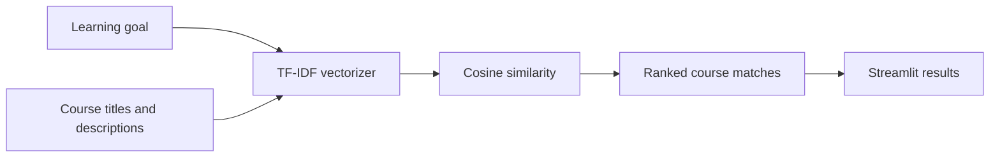

# Course Compass

**A content-based course discovery app that turns a free-text learning goal into ranked recommendations.**

Course catalogs can be difficult to search when a learner knows the skill they want but not the exact course title. Course Compass compares a learner's description with course titles and descriptions, then returns the closest matches from a bundled catalog of 499 courses.

## Demo

Run the app locally using the steps below. The application works offline after dependencies are installed; course links open on Coursera.

## How it works



1. Load and validate the bundled course catalog.
2. Combine each course title and description into searchable text.
3. Fit a TF-IDF model with English stop words and unigrams plus bigrams.
4. Transform the learner's query with the same vectorizer.
5. Rank courses by cosine similarity and return the highest scoring matches.

The catalog and TF-IDF matrix are cached for the lifetime of the app process. Results with no shared terms are omitted. The displayed match score is a text-similarity score; it does not measure course quality or guarantee semantic relevance.

## Run locally

**Requirements:** Python 3.10 or newer.

```bash
git clone https://github.com/Stella747/AI_Course_Recommendation_Chatbot.git
cd AI_Course_Recommendation_Chatbot
python -m venv .venv
```

Activate the environment, then install and launch:

```bash
# macOS / Linux
source .venv/bin/activate

# Windows PowerShell
# .venv\Scripts\Activate.ps1

python -m pip install -r requirements.txt
streamlit run app.py
```

Streamlit prints a local URL when the app is ready. Enter a learning goal, choose how many results to show, and select **Find courses**.

## Project structure

```text
.
├── app.py              # Streamlit user interface
├── model.py            # Catalog loading and recommendation logic
├── data/
│   └── courses.json    # Bundled course catalog snapshot
├── requirements.txt
└── README.md
```

## Data and limitations

The app uses a bundled snapshot of course names, descriptions, and slugs in `data/courses.json`. It does not fetch catalog updates. Availability and course details can change, so check the linked course page for current information. The matching method is lexical: it may miss synonyms and can rank courses highly because they share common words. It is a learning project and does not claim to use a large language model or personalized learner history.

## Possible next steps

- Evaluate recommendation relevance with a small labeled query set and ranking metrics such as Precision@K.
- Add dataset provenance, refresh instructions, and data validation as the catalog is maintained.
- Compare TF-IDF results with a semantic embedding baseline and report the trade-offs.
- Add automated tests for data loading, empty input, ranking, and zero-overlap queries.

## Built with

Python · Streamlit · pandas · scikit-learn

## Author

Renu Meena
